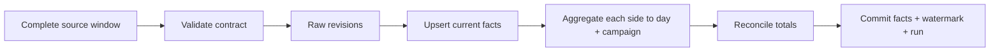

# Ads and CRM → reconciled analytics

[](https://github.com/aistrategyc/analytics-pipeline-lab/actions/workflows/ci.yml)

An advertising API revises yesterday's spend. A CRM conversion arrives late.
Rerunning the import should correct the report without counting either record twice.

This **Python + PostgreSQL** example loads synthetic Google Ads, Meta Ads and CRM
batches into immutable source revisions, current facts and a daily reporting view.
It demonstrates the data contracts behind a dashboard; it does not call the
advertising platforms.

Related work: [IT STEP data and analytics](https://github.com/aistrategyc/aistrategyc/blob/main/cases/itstep.md).
Client rows, credentials and workflow exports are not part of this repository.



## Run the fixture

Requires Docker Compose and [uv](https://docs.astral.sh/uv/getting-started/installation/).

```sh
git clone https://github.com/aistrategyc/analytics-pipeline-lab.git
cd analytics-pipeline-lab
cp .env.example .env
set -a; . ./.env; set +a
docker compose up -d --wait
uv sync --locked
uv run lab demo
uv run pytest
```

The fixture produces **14,000 minor units of spend, 45,000 of revenue, three
orders and ROAS 3.2143**. These are synthetic PLN amounts: 140.00 spend and
450.00 revenue. Run the demo again: no fact rows change.

The demo fixes its clock at `2026-10-20T12:00:00Z` so freshness is reproducible.
Use `uv run lab report` to compare the same watermarks with the current time.
These are not live metrics.

To load your own synthetic batch:

```sh
uv run lab load --file src/analytics_lab/fixtures/crm.json
```

## The important parts

| Mechanism | Purpose |
|---|---|
| Source + record ID + update time | Retain each source revision and detect conflicting payloads |
| Newer-version upsert | Apply corrections without overwriting a newer fact with old data |
| Two-day update-time lookback | Revisit delayed source updates around the watermark |
| Source-level advisory lock | Serialize concurrent runs, including the first load |
| Shared transaction | Roll back raw rows, facts and watermark if any step fails |
| Aggregate before joining | Avoid multiplying spend by the number of matching conversions |
| Reconciliation | Compare reporting totals with independent fact-table totals |
| Freshness report | Distinguish a stale source from a source that has never loaded |

Money uses integer minor units. This example accepts PLN only and never adds
different currencies together. `campaign_id` is an upstream canonical attribution
key; there is no invented multi-touch attribution algorithm.

## Inspect the implementation

- [Batch contract](src/analytics_lab/contracts.py): a complete extraction window,
  timezone-aware update timestamps and strict monetary values.
- [Pipeline](src/analytics_lab/pipeline.py): lookback, revisions, fact upsert,
  reconciliation and atomic checkpoint.
- [SQL](src/analytics_lab/sql/001_initial.sql): constraints, lineage and reporting grain.
- [Tests](tests/test_pipeline.py): duplicates, corrections, late events, concurrent
  loads, rollback, partial batches, stale data and a deliberately broken reporting view.

## Where n8n fits

An n8n workflow can schedule the extraction and paginate a source API, then hand
off a complete batch to this loader. The loader owns validation and database
consistency. A successful HTTP page is not a completed extraction window.

No n8n workflow or live Ads connector is shipped here. That adapter must handle
credentials, pagination, provider quotas and its own tests. Keeping this boundary
explicit makes the same data contract usable from n8n, a Python worker or a scheduler.

[Design and recovery](docs/design.md) · [Operating notes](docs/operations.md)

By [Kyrylo Prolieiev](https://github.com/aistrategyc) · [Engineering portfolio](https://proleev.com/en) · MIT
