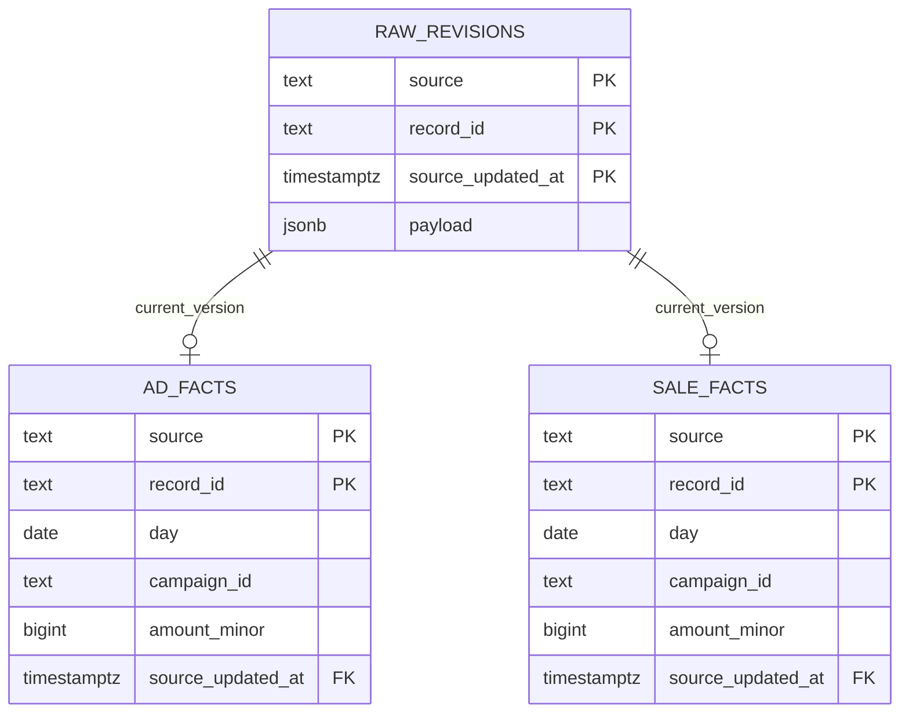

# A watermark is a promise about completeness

The input contract includes `window_start`, `window_end` and `complete: true`.
An adapter must finish all pages for that window before setting the flag.
The loader can validate the contract; it cannot prove that a remote API returned
every expected record. Production extraction needs independent completeness checks.

On a first run the declared start establishes the baseline. Subsequent runs must
cover at least `previous watermark - 2 days`. The state advances to the window end
only after validation, raw insertion, fact updates and reconciliation commit.
An empty but complete window can advance the watermark.

## Two kinds of lateness

A conversion may belong to September but be updated in October. Its update time
puts it in the current extraction window; its business date places it in the
September report.

A source may instead expose an update late while retaining an older update time.
The lookback catches it only while that time is inside the two-day window.
Anything older needs a controlled backfill. There is no guarantee against
arbitrarily late source corrections.

## Avoiding join fan-out

Two spend records joined directly to three orders produce six rows. Summing after
that join overstates both measures. `daily_metrics` first aggregates each source
to `(day, campaign_id)`, then joins the aggregates.

Reconciliation compares the view with independent spend, revenue and order
totals in one SQL statement, so every total uses the same database snapshot.
This detects reporting-grain errors. It does not prove that source attribution
or source amounts are correct.

## Failure and recovery

A conflicting revision, a failed fact write or failed reconciliation rolls back
the entire batch. The previous watermark remains usable. Successful run records
commit with the data; failed runs appear as CLI errors and do not receive a
success row. A scheduler should record and alert on those failures separately.

Fix the input and rerun the same window. A normal retry does not require deleting
facts or resetting the checkpoint. Schema changes use new numbered migrations.

## Limits

The loader holds a bounded batch in memory (up to 100,000 input records) and
reconciles the whole small reporting view. This is not a throughput benchmark.
Large datasets need chunked extraction, partition-aware loading and measured
query plans.

Deletions, refunds, currency conversion, identity resolution and API authentication
are outside this contract. Deleting a source record is not represented by its
absence in a later batch. Add an explicit tombstone contract before handling that.

[Operating notes](operations.md)
